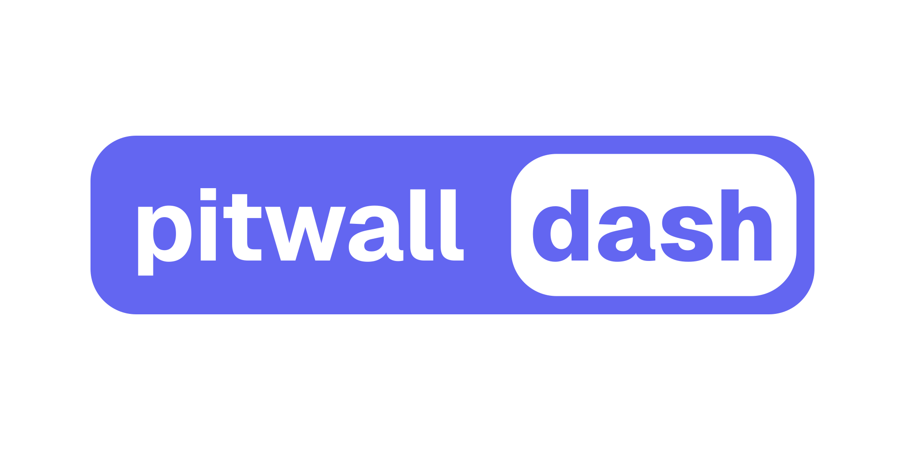

  

<h1 align="center">Real-time race telemetry and timing</h1>

## Pitwall Dash

A real-time race dashboard that shows the leader board, tyres, gaps, laps, mini sectors and much more. Live at [pitwalldash.com](https://pitwalldash.com).

## Credits

Pitwall Dash is a fork of [f1-dash](https://github.com/slowlydev/f1-dash) by [Slowly](https://slowly.dev), licensed under the [GNU AGPL v3](LICENSE). If you'd like to support the original project, you can [buy Slowly a coffee](https://www.buymeacoffee.com/slowlydev).

## Notice

This project/website is unofficial and is not associated in any way with the Formula 1 companies. F1, FORMULA ONE, FORMULA 1, FIA FORMULA ONE WORLD CHAMPIONSHIP, GRAND PRIX and related marks are trade marks of Formula One Licensing B.V.
